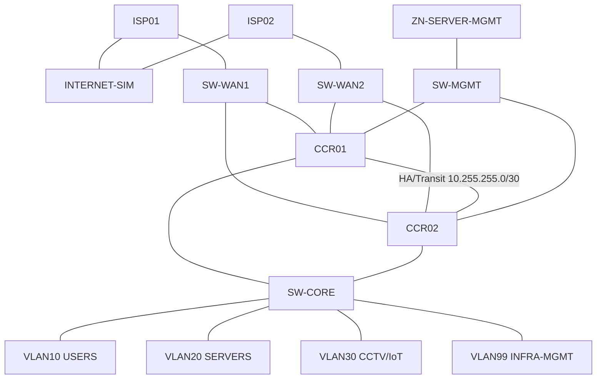

# LAB-001 — Arquitectura real y fases

**Plataforma:** GNS3 + MikroTik CHR RouterOS 7.23.7 long-term.

## Baseline confirmado
- CCR01 y CCR02: CHR, RouterOS 7.23.7 long-term, 512 MiB RAM.
- SW-CORE y SW-MGMT: CHR, RouterOS 7.23.7 long-term, 256 MiB RAM.
- SW-CORE: bridge1, vlan-filtering=no al inicio.
- SW-MGMT: bridge-MGMT, red OOB 10.50.250.0/24.
- Enlaces HA y OOB verificados con 0% de pérdida.

## Fases
1. Baseline e inventario — EN CURSO.
2. VLAN 10/20/30/99 y trunks CCR↔SW-CORE.
3. VRRP por VLAN.
4. Routing interno y OSPF área 0 donde aporte valor.
5. Dual WAN y failover.
6. Firewall y segmentación.
7. Observabilidad y fallos controlados.
8. Evidencia y cierre.
