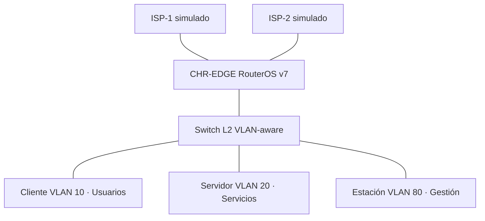

# LAB-001 — Arquitectura y alcance

**Estado:** Diseño propuesto. No desplegado.

## Objetivo
Segmentar una red empresarial simulada, filtrar tráfico entre zonas y validar dos caminos WAN de forma controlada.

El switch elegido debe soportar explícitamente 802.1Q y troncales; no asumir que el switch Ethernet básico de GNS3 reproduce las funciones de uno gestionable.

## Fases
1. **A — Baseline:** interfaces verificadas, VLAN, direccionamiento, política firewall y conectividad principal.
2. **B — Resiliencia:** ISP2, rutas priorizadas, detección de fallo y medición de recuperación.
3. **C — Observabilidad:** syslog, métricas, versiones y reporte.
4. **D — Opcional:** OSPF o VPN en topología separada.

## Pendientes
Confirmar adaptadores e interfaces reales, plantillas GNS3, capacidades del host, hardware virtual y routers simulados de ISP. Mantener acceso de consola y rollback antes de endurecer el firewall.
