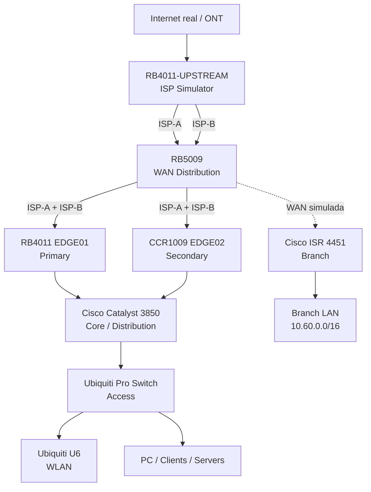

# LAB-001 — Arquitectura física y fases

**Plataforma objetivo:** laboratorio físico multivendor.

## Topología de referencia



## Roles

| Equipo | Rol |
|---|---|
| RB4011 principal | Upstream real y simulador de ISP |
| RB5009 | Distribución L2 de ISP-A e ISP-B |
| RB4011 #2 | EDGE01 — activo/preferido |
| CCR1009 | EDGE02 — pasivo/respaldo |
| Cisco Catalyst 3850 | Core/Distribution L3 |
| Ubiquiti Pro Switch | Access layer |
| Ubiquiti U6 | WLAN corporativa/IoT/Guest |
| Cisco ISR 4451 | Branch / sede remota simulada |

## Modelo de redundancia V1

La primera versión será **active-passive en la capa Edge**, manteniendo ambos ISP disponibles en ambos routers:

```
                 ISP-A        ISP-B
                    \          /
                     \ RB5009 /
                    /          \
              RB4011 EDGE01   CCR1009 EDGE02
                ACTIVE           STANDBY
                    \            /
                     Cisco 3850
```

Esto permite probar dos niveles independientes de resiliencia:

1. **Falla de ISP:** el router activo conserva conectividad mediante el segundo proveedor.
2. **Falla de router Edge:** el router secundario asume y conserva acceso a ISP-A e ISP-B.

Una fase posterior podrá implementar y comparar active-active.

## Diseño WAN

El RB5009 no debe rutear entre ISP-A e ISP-B. Su función es mantener dos dominios L2 independientes y distribuir cada dominio a ambos routers Edge.

Asignación física propuesta:

| RB5009 | Función |
|---|---|
| ether1 | Entrada ISP-A desde RB4011 upstream |
| ether2 | Entrada ISP-B desde RB4011 upstream |
| ether3 | ISP-A hacia RB4011 EDGE01 |
| ether4 | ISP-B hacia RB4011 EDGE01 |
| ether5 | ISP-A hacia CCR1009 EDGE02 |
| ether6 | ISP-B hacia CCR1009 EDGE02 |
| ether7-8 | Reserva para Branch / expansión |

## Campus interno

El Cisco 3850 será el Core/Distribution y el Ubiquiti Pro Switch quedará aguas abajo como capa de acceso.

VLANs objetivo iniciales:

- VLAN 10 — USERS
- VLAN 20 — SERVERS
- VLAN 30 — CCTV / IoT
- VLAN 40 — GUEST
- VLAN 99 — MANAGEMENT

El U6 permitirá mapear SSID distintos a VLANs para validar segmentación inalámbrica.

## Branch

El Cisco ISR 4451 representará una sede externa. No tendrá conexión directa a la LAN HQ. Su LAN utilizará el bloque 10.60.0.0/16 y la conectividad con HQ se implementará posteriormente mediante IPsec, routing sobre túnel y/o escenarios SD-WAN.

## Fases

1. Inventario físico y documentación — IN PROGRESS.
2. ISP simulator en RB4011 upstream — IN PROGRESS.
3. Distribución WAN en RB5009 — NEXT.
4. Conectividad dual-WAN en RB4011 EDGE01 y CCR1009 EDGE02.
5. Core/Distribution Cisco 3850.
6. VLANs y trunking hacia Ubiquiti Pro.
7. WLAN U6 y segmentación.
8. Active-passive Edge y pruebas de failover.
9. Branch Cisco 4451 e IPsec.
10. Observabilidad, seguridad y pruebas de falla.
11. Comparación posterior active-passive vs active-active.

## Nota sobre GNS3

La topología GNS3 previa se conserva como sandbox/twin del diseño. Sus resultados históricos siguen documentados, pero ya no representan la implementación principal de LAB-001.
